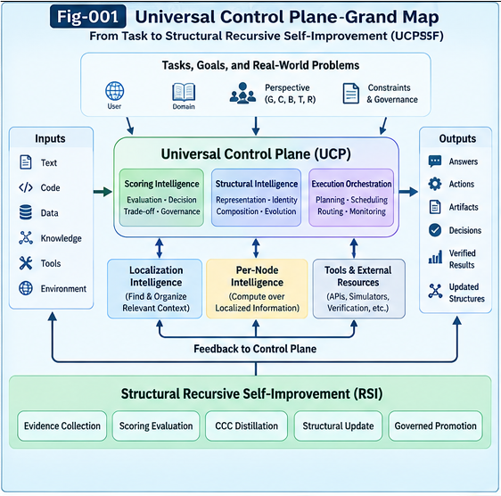
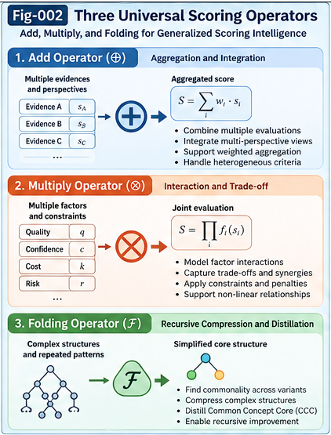
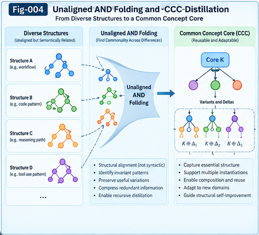
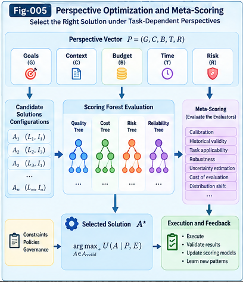
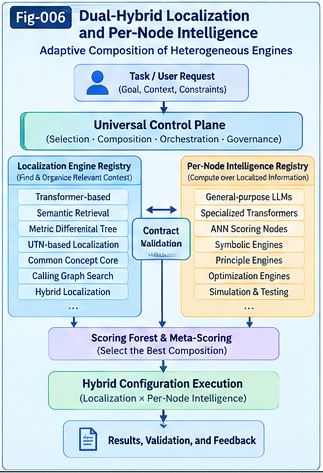
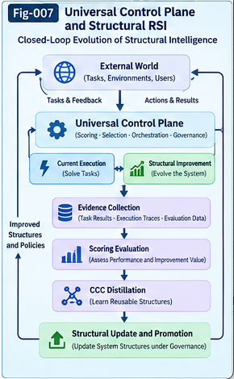

# Universal Control Planes and Scoring Tree/Forest/Folding for Structural Intelligence

### From Generalized Scoring Intelligence to Hybrid AI, Governed Structural RSI, and Open-Ended Structural Evolution

**Authors:** Sizhe Tan & GPT-Obot  
**Version:** 1.0.0  
**Status:** Research Framework and Proposed Architecture  
**Date:** October 15, 2026  
**License:** Apache-2.0

---

## 1. Overview

**How should increasingly complex AI systems evaluate, select, compose, govern, and improve their own intelligence structures?**

Modern AI systems increasingly operate through multi-stage workflows involving multiple models, tools, specialized evaluators, context-localization mechanisms, and recursive improvement processes.

These systems require more than powerful computation.

They require mechanisms for:

- Selecting relevant intelligence engines;
- Evaluating candidate solutions and computational paths;
- Managing cost, uncertainty, and risk;
- Learning reusable evaluation structures;
- Coordinating heterogeneous intelligence components;
- Governing structural modifications;
- Preserving independent evidence and counter-evidence.

This repository proposes **Universal Control Planes and Scoring Tree/Forest/Folding (UCPSF)** as a research framework for these challenges.

Its central proposition is:

> **Scoring Intelligence itself can become a structurally learnable, transferable, and recursively improvable form of intelligence.**

A complementary architectural proposition is:

> **Complex AI systems may benefit from Universal Control Planes that coordinate Hybrid Intelligence, Scoring Forests, evidence-driven learning, and governed Structural Recursive Self-Improvement.**

The framework is conceptual and research-oriented. Its proposed mechanisms require formalization, implementation, and empirical validation.

---

## 2. The Two Foundational Research Pillars

UCPSF integrates two complementary research directions.

### Pillar I — Generalized Scoring Intelligence

Conventional AI evaluation often relies on fixed metrics, reward functions, ranking models, or task-specific evaluators.

UCPSF investigates evaluation as a broader structural intelligence capability.

This includes:

- Scoring Trees;
- Scoring Forests;
- Value-Based Folding;
- Branching-Based Folding;
- ANN Scoring Nodes;
- Unaligned AND Folding;
- Common Concept Core (CCC) extraction;
- Recursive CCC distillation;
- Perspective-Aware Meta-Scoring.

The objective is to investigate whether evaluation structures can be learned, composed, reused, specialized, and improved.

### Pillar II — Hybrid Structural Intelligence

UCPSF distinguishes two functional responsibilities:

**Localization Intelligence**

Identifying, retrieving, organizing, and selecting relevant context.

**Per-Node Intelligence**

Performing reasoning, generation, evaluation, optimization, or verification over localized information.

These functions may be tightly integrated, as in Transformer-based systems, or composed from heterogeneous engines.

Potential Localization Engines include:

- Transformer-based contextual processing;
- Semantic retrieval;
- Metric Differential Trees (MDT);
- UTN-based structural localization;
- CCC matching;
- Calling Graph traversal.

Potential Per-Node Intelligence Engines include:

- General-purpose LLMs;
- Specialized Transformers;
- ANN scorers;
- Principle Engines;
- Symbolic reasoning systems;
- Optimizers;
- Simulators and external tools.

The research objective is **adaptive coupling and decoupling**, not a universal preference for modularity over integrated models.

---

## 3. The Universal Control Plane

The Universal Control Plane (UCP) is the proposed architectural mechanism connecting the two research pillars.

It coordinates:

1. Perspective and task objectives;
2. Contracts and component compatibility;
3. Localization and Intelligence Engine selection;
4. Scoring Trees and Forests;
5. Meta-Scoring;
6. Resource allocation;
7. Evidence and counter-evidence;
8. Policy and authorization;
9. Structural learning and promotion;
10. Monitoring and rollback.

The Control Plane is not merely a scoring function or workflow orchestrator.

It is a proposed logical architecture for coordinating computation, evaluation, governance, and structural evolution.



**Fig-001.** Universal Control Plane Grand Map — from task requirements and hybrid computation to scoring, evidence, governance, and Structural RSI.

---

## 4. Three Universal Scoring Operator Families

UCPSF proposes three candidate families of scoring-related structural operations.

| Operator Family | Main Function | Candidate Applications |
|---|---|---|
| **Value-Based Folding** | Adjust, calibrate, combine, or compress scoring values | Metric weighting, normalization, calibration |
| **Branching-Based Folding** | Select, merge, specialize, or reorganize evaluation branches | Scoring Tree optimization, workflow control |
| **ANN Scoring Nodes** | Learn approximate or specialized evaluation functions | Fast ranking, scorer distillation, dispatch |

These families are research abstractions, not an exhaustive classification of all scoring methods.



**Fig-002.** Three proposed Scoring Operator families and their roles in generalized evaluation.

---

## 5. Scoring Trees, Forests, and the Aspen Grove Model

### 5.1 Scoring Trees

A Scoring Tree organizes evaluation into connected nodes representing metrics, constraints, decision rules, learned scorers, or aggregation operations.

### 5.2 Scoring Forests

A Scoring Forest contains multiple evaluation structures.

Different trees may correspond to different:

- Tasks;
- Domains;
- Perspectives;
- Risk profiles;
- Evaluation strategies.

### 5.3 Aspen Grove — Core±Delta

The Aspen Grove analogy illustrates the coexistence of shared structural roots and specialized branches.

A candidate decomposition is:

$$
\[
T_i \approx K \oplus \Delta_i
\]
$$

where:

- \(T_i\): Individual Scoring Tree;
- \(K\): Shared Common Concept Core;
- \(\Delta_i\): Specialized structural or behavioral differences.

The objective is not maximal compression.

It is to preserve reusable commonality while retaining decision-relevant diversity.


**Fig-003.** Individual Scoring Trees, Scoring Forests, and the Aspen-inspired shared-root architecture.

---

## 6. Unaligned AND Folding and Recursive CCC Distillation

Different evaluation structures may express similar principles without having identical topologies.

**Unaligned AND Folding** investigates whether common structural or behavioral patterns can be identified across heterogeneous Scoring Trees.

A proposed research sequence is:

1. Model primitive Scoring Trees;
2. Collect related Scoring Tree samples;
3. Identify candidate commonality through Unaligned AND Folding;
4. Extract and independently validate candidate CCCs;
5. Compare CCCs across evaluation families;
6. Revise, specialize, or promote validated structures through new evidence.

The resulting CCCs may be reused across tasks and Perspectives.

However, structural similarity alone does not establish behavioral equivalence.



**Fig-004.** Proposed extraction of reusable Common Concept Cores from heterogeneous evaluation structures.

---

## 7. Perspective-Aware Optimization and Meta-Scoring

Evaluation criteria depend on the task and operating context.

UCPSF represents Perspective as:

$$
\[
P=(G,C,B,T,R)
\]
$$

where:

- \(G\): Goals;
- \(C\): Context and constraints;
- \(B\): Resource budget;
- \(T\): Time horizon;
- \(R\): Risk preferences.

**Meta-Scoring Intelligence** evaluates the evaluators themselves.

It may consider:

- Calibration;
- Predictive validity;
- Robustness;
- Applicability;
- Cost;
- Independence;
- Transferability.

This supports adaptive selection of evaluation structures.

Mandatory governance constraints remain distinct from compensable score dimensions.



**Fig-005.** Perspective-aware evaluation, Scoring Forest selection, and Meta-Scoring.

---

## 8. Dual-Hybrid Localization and Per-Node Intelligence

The Dual-Hybrid architecture proposes separate registries for Localization Engines and Per-Node Intelligence Engines.

A candidate configuration may be represented as:

$$
\[
a=(L_i,I_j,C_{ij})
\]
$$

where:

- \(L_i\): Localization Engine;
- \(I_j\): Per-Node Intelligence Engine;
- \(C_{ij}\): Composition contract.

The Universal Control Plane selects among compatible configurations according to Perspective, evidence, cost, risk, and task requirements.

An integrated Transformer remains a valid candidate.

The objective is to investigate when adaptive hybrid composition improves measurable outcomes.



**Fig-006.** Adaptive composition of heterogeneous Localization and Per-Node Intelligence Engines.

---

## 9. Governed Structural Recursive Self-Improvement

Structural RSI expands recursive improvement beyond model parameters and prompts.

Candidate modifications may include:

- Localization architectures;
- Per-Node Intelligence Engines;
- Dispatch and Calling Graphs;
- Scoring Trees;
- CCC structures;
- Context representations;
- Composition contracts.

UCPSF proposes a controlled lifecycle:

**Proposal → Contract Validation → Sandbox Evaluation → Independent Validation → Authorization → Controlled Deployment → Monitoring / Rollback**

Two forms of evolution must be distinguished:

**Intelligence Architecture Evolution**

Improving how tasks are performed.

**Evaluation Architecture Evolution**

Improving how tasks and structural changes are judged.

These processes may interact, but a candidate must not establish its own superiority merely by modifying the evaluation criteria used to judge it.



**Fig-007.** Evidence-driven and governed structural evolution under a Universal Control Plane.

---

## 10. Research Documents

The repository contains eight core research papers.

| ID | Research Paper | Focus |
|---|---|---|
| UCPSF-001 | [From Primitive Scoring to Generalized Scoring Intelligence](docs/UCPSF-001-From-Primitive-Scoring-to-Generalized-Scoring-Intelligence.md) | Scoring as an intelligence capability |
| UCPSF-002 | [Universal Control Planes and Three Scoring Operators](docs/UCPSF-002-Universal-Control-Planes-and-Three-Scoring-Operators.md) | Value, branching, and ANN scoring |
| UCPSF-003 | [Scoring Trees, Forests, and Unaligned AND Folding](docs/UCPSF-003-Scoring-Trees-Forests-and-Unaligned-AND-Folding.md) | Structured evaluation and folding |
| UCPSF-004 | [Common Concept Core Extraction and Recursive Distillation](docs/UCPSF-004-Common-Concept-Core-Extraction-and-Recursive-Distillation.md) | Recursive CCC learning |
| UCPSF-005 | [Perspective-Aware Optimization and Meta-Scoring Intelligence](docs/UCPSF-005-Perspective-Aware-Optimization-and-Meta-Scoring-Intelligence.md) | Evaluating evaluators |
| UCPSF-006 | [Hybrid Localization and Per-Node Intelligence](docs/UCPSF-006-Hybrid-Localization-and-Per-Node-Intelligence.md) | Dual-Hybrid architecture |
| UCPSF-007 | [Universal Control Plane Architecture and Structural RSI](docs/UCPSF-007-Universal-Control-Plane-Architecture-and-Structural-RSI.md) | Governed structural evolution |
| UCPSF-008 | [Open-Ended Scoring Intelligence and the Future of AI](docs/UCPSF-008-Open-Ended-Scoring-Intelligence-and-the-Future-of-AI.md) | Open-ended and collective learning |

---

## 11. Case Studies

Three conceptual case studies connect the proposed framework to concrete execution scenarios.

### CASE-001 — Scoring Control in AI Relay

[Read CASE-001](cases/CASE-001-Scoring-Control-in-AI-Relay.md)

Investigates how Scoring Trees and Forests can guide:

- Acceptance;
- Continuation;
- Retry;
- Delegation;
- Escalation;
- Termination.

### CASE-002 — Scoring-Guided Structural RSI

[Read CASE-002](cases/CASE-002-Scoring-Guided-Structural-RSI.md)

Investigates how Rich Evaluators, independent validation, counter-evidence, and governed promotion may guide recursive structural improvement.

### CASE-003 — Hybrid Localization and Per-Node Selection

[Read CASE-003](cases/CASE-003-Hybrid-Localization-and-Per-Node-Selection.md)

Investigates adaptive selection and composition of heterogeneous Localization and Per-Node Intelligence Engines.

These case studies present proposed algorithms and validation designs, not completed experimental results.

---

## 12. Repository Structure

```text id="l8l92w"
Universal-Control-Planes-and-Scoring-Folding/
│
├── README.md
├── START-HERE.md
├── CONTENTS.md
├── GLOSSARY.md
├── FIGURE-INDEX.md
├── FUTURE-DIRECTIONS.md
├── OPEN-QUESTIONS.md
├── CHANGELOG.md
├── CITATION.cff
├── .zenodo.json
├── LICENSE.txt
│
├── docs/
│   ├── UCPSF-001-From-Primitive-Scoring-to-Generalized-Scoring-Intelligence.md
│   ├── UCPSF-002-Universal-Control-Planes-and-Three-Scoring-Operators.md
│   ├── UCPSF-003-Scoring-Trees-Forests-and-Unaligned-AND-Folding.md
│   ├── UCPSF-004-Common-Concept-Core-Extraction-and-Recursive-Distillation.md
│   ├── UCPSF-005-Perspective-Aware-Optimization-and-Meta-Scoring-Intelligence.md
│   ├── UCPSF-006-Hybrid-Localization-and-Per-Node-Intelligence.md
│   ├── UCPSF-007-Universal-Control-Plane-Architecture-and-Structural-RSI.md
│   └── UCPSF-008-Open-Ended-Scoring-Intelligence-and-the-Future-of-AI.md
│
├── cases/
│   ├── CASE-001-Scoring-Control-in-AI-Relay.md
│   ├── CASE-002-Scoring-Guided-Structural-RSI.md
│   └── CASE-003-Hybrid-Localization-and-Per-Node-Selection.md
│
├── figures/
│   ├── Fig-001-Universal-Control-Plane-Grand-Map.png
│   ├── Fig-002-Three-Universal-Scoring-Operators.png
│   ├── Fig-003-Scoring-Trees-Forests-and-Aspen-Root-System.png
│   ├── Fig-004-Unaligned-AND-Folding-and-CCC-Distillation.png
│   ├── Fig-005-Perspective-Optimization-and-Meta-Scoring.png
│   ├── Fig-006-Dual-Hybrid-Localization-and-Per-Node-Intelligence.png
│   └── Fig-007-Universal-Control-Plane-and-Structural-RSI.png
│
└── release/
    ├── GitHub-Release-Notes-v1.0.0.md
    ├── ResearchGate-Description.txt
    └── UCPSF-v1.0.0-ResearchGate-Overview.pdf
```

---

## 13. Research Methodology

UCPSF follows a theory-first research approach.

The initial release emphasizes:

- Architectural definitions;
- Conceptual algorithms;
- Structural representations;
- Research hypotheses;
- Failure-mode analysis;
- Experimental validation plans.

It does not claim completed implementation or benchmark validation.

Future research should compare the proposed mechanisms against simpler alternatives under controlled conditions.

### Validation Priorities

1. Scoring Operator effectiveness;
2. Decision-preserving structural folding;
3. CCC extraction and transfer;
4. Perspective-Aware Meta-Scoring;
5. Adaptive Hybrid Intelligence selection;
6. Governed Structural RSI;
7. Collective Structural Learning.

---

## 14. Open Research Questions

Major unresolved questions include:

- What constitutes a generalizable Scoring CCC?
- How can Unaligned AND Folding preserve decision-relevant behavior?
- When should evaluation structures be merged, specialized, or kept separate?
- How can Meta-Scoring avoid circular self-validation?
- What is the appropriate balance between integrated and modular intelligence?
- How should a Universal Control Plane enforce authority across distributed systems?
- Can Structural RSI improve both task performance and evaluation quality without uncontrolled drift?
- How can portable intelligence structures support collective learning while preserving local sovereignty?
- What measurable benefits distinguish UCPSF from conventional orchestration and evaluation frameworks?

See [OPEN-QUESTIONS.md](OPEN-QUESTIONS.md) for the extended research agenda.

---

## 15. Related Structural Intelligence Research

UCPSF builds upon a broader Structural Intelligence research program.

### Structural Recursive Self-Improvement

https://github.com/sizhet/Structural-Recursive-Self-Improvement

### Generalized Structural Trigger and Computational Growth Intelligence

https://github.com/sizhet/Generalized-Structural-Trigger-and-Computational-Growth-Intelligence

### Portable Intelligence Runtime Pieces and Units

https://github.com/sizhet/Portable-Intelligence-Runtime-Pieces-and-Units

### Principle Intelligence and Open Structural Learning

https://github.com/sizhet/Principle-Intelligence-and-Open-Structural-Learning

### Metric Differential Tree, UTN, and Context-Bound Token Intelligence

https://github.com/sizhet/Metric-Differential-Tree-UTN-and-Context-Bound-Token-Intelligence

### Pre-AGI AI Action Governance

https://github.com/sizhet/Pre-AGI-AI-Action-Governance

These projects provide conceptual background and research continuity. They should not be interpreted as independent empirical validation of UCPSF.

---

## 16. Future Directions

The long-term research direction is to investigate whether complex intelligence systems can progressively improve:

- Their evaluation structures;
- Their computational architectures;
- Their localization mechanisms;
- Their structural representations;
- Their resource allocation;
- Their governance processes;
- Their ability to reuse validated intelligence components.

The ultimate research objective is not merely greater system complexity.

It is **more effective, reusable, evidence-driven, and governable structural intelligence**.

See [FUTURE-DIRECTIONS.md](FUTURE-DIRECTIONS.md).

---

## 17. Research Position and Limitations

UCPSF is a proposed research framework.

The following distinctions are important:

- A Scoring Forest is not automatically superior to a single evaluator.
- Structural Folding does not automatically preserve decision behavior.
- A candidate CCC is not necessarily universally applicable.
- Meta-Scoring does not eliminate evaluator bias.
- Hybrid architectures do not necessarily outperform integrated models.
- Structural RSI does not guarantee recursive improvement.
- A Universal Control Plane does not provide a complete formal safety guarantee.

The value of the framework must be established through reproducible evidence.

---

## 18. Citation

If you use or discuss this research, please cite the repository and the relevant individual document.

**Suggested citation before DOI assignment:**

Tan, S., & GPT-Obot. (2026). *Universal Control Planes and Scoring Tree/Forest/Folding for Structural Intelligence (UCPSF)* (Version 1.0.0). GitHub.

Repository:

https://github.com/sizhet/Universal-Control-Planes-and-Scoring-Folding

DOI: To be assigned following the archived release.

See [CITATION.cff](CITATION.cff) for machine-readable citation metadata.

---

## 19. License

This repository is released under the **Apache License 2.0**.

See [LICENSE.txt](LICENSE.txt).

---

## 20. Final Perspective

The UCPSF research program proposes a progression:

**Primitive Scoring → Scoring Intelligence → Scoring Trees and Forests → Recursive CCC Distillation → Meta-Scoring → Universal Control Plane → Governed Structural RSI → Open-Ended Structural Learning**

Its defining proposition is:

> **The intelligence that evaluates, selects, and governs computation may itself become an important object of structural learning and evolution.**

The long-term vision is a transition:

**From fixed evaluation and fixed computational architectures toward governed, composable, and recursively improvable Structural Intelligence systems.**

---

**Universal Control Planes and Scoring Tree/Forest/Folding for Structural Intelligence**  
**Sizhe Tan & GPT-Obot — 2026**  
**Version 1.0.0 | Apache-2.0**

