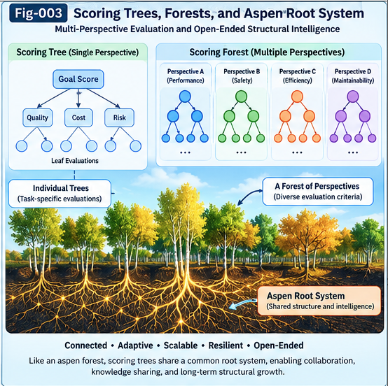

# UCPSF-003 — Scoring Trees, Forests, and Unaligned AND Folding

**Subtitle:** Discovering Reusable Evaluation Principles Across Heterogeneous Scoring Structures

**Authors:** Sizhe Tan & GPT-Obot  
**Project:** Universal Control Planes and Scoring Tree/Forest/Folding for Structural Intelligence (UCPSF)  
**Document ID:** UCPSF-003  
**Version:** 1.0.0  
**Date:** October 19, 2026  
**Status:** Research Framework and Proposed Structural Algorithm  
**License:** Apache-2.0

---

## Abstract

Complex artificial intelligence systems increasingly depend on heterogeneous scoring mechanisms for evaluating candidates, selecting execution paths, allocating computation, and governing structural evolution.

These mechanisms often differ in topology, representation, parameters, evaluation semantics, and domain-specific constraints. Nevertheless, they may share reusable evaluation and control principles.

This paper introduces **Scoring Trees**, **Scoring Forests**, and **Unaligned AND Folding** as a structural framework for discovering such commonality.

A Scoring Tree represents evaluation dependencies, scoring operators, evidence relationships, and decision-control semantics. A Scoring Forest organizes multiple Scoring Trees across tasks, domains, perspectives, and time horizons.

Unaligned AND Folding is proposed as a family of structural operations that identifies candidate common evaluation principles across scoring structures without requiring predefined node-to-node alignment.

The proposed method combines semantic localization, functional correspondence discovery, structural alignment, candidate Common Concept Core extraction, behavioral validation, and counter-evidence testing.

We distinguish **Structural CCC**, which preserves reusable structural relationships, from **Behavioral CCC**, which captures recurring evaluation or decision behavior under specified contexts.

A central principle is that Folding must preserve decision-relevant information rather than merely reduce structural size. Consequently, a useful folded representation may contain a shared core, specialized differences, applicability boundaries, and uncertainty metadata.

The paper also develops the **Aspen Forest and Shared Root System** analogy as an intuitive model of distributed structural commonality.

The proposed framework establishes an algorithmic foundation for recursive CCC distillation, perspective-aware scoring, AI Relay, and Structural Recursive Self-Improvement.

**Keywords:** Scoring Tree, Scoring Forest, Unaligned AND Folding, Common Concept Core, Structural Folding, Behavioral Equivalence, Structural Intelligence, Generalized Scoring Intelligence, Universal Control Plane, Counter-Evidence, Decision Preservation, Structural RSI

---



**Fig-003.** Individual Scoring Trees, Scoring Forests, and the Aspen-inspired shared-root architecture.

---

## 1. Introduction

### 1.1 From Scoring Operators to Scoring Structures

UCPSF-001 introduced Generalized Scoring Intelligence as a research direction.

UCPSF-002 proposed three candidate scoring operator families:

1. Value-Based Folding;
2. Branching-Based Folding;
3. ANN Scoring Nodes.

These operators provide local mechanisms for evaluating candidates, modifying scoring parameters, transforming branches, and approximating evaluation functions.

However, real-world intelligence systems rarely consist of isolated scoring operations.

An AI Relay system may combine quality estimation, risk evaluation, resource constraints, candidate comparison, and delegation decisions.

A Structural RSI system may evaluate proposed modifications according to performance, robustness, transferability, cost, and governance requirements.

Such systems require structured relationships among scoring operations.

This motivates the transition:

**Scoring Operator → Scoring Tree → Scoring Forest → Structural Folding → Reusable CCC.**

### 1.2 The Heterogeneity Problem

Two scoring systems may perform related evaluation functions while having different internal structures.

For example, one system may use:

- Explicit weighted metrics;
- Hierarchical decision branches;
- Threshold-based rejection.

Another may use:

- Learned neural scoring;
- Pairwise ranking;
- Confidence-based escalation.

The systems may implement similar control principles despite lacking matching nodes or equivalent representations.

A simple structural intersection would fail to recognize much of this commonality.

### 1.3 Research Question

The central research question is:

> How can reusable evaluation and control principles be discovered across heterogeneous Scoring Trees without assuming predefined structural alignment?

This paper proposes **Unaligned AND Folding** as a candidate approach.

### 1.4 Research Scope

The paper develops a conceptual algorithm and associated validation requirements.

It does not establish that arbitrary scoring structures can always be aligned or folded.

It does not claim that commonality extraction necessarily improves evaluation quality.

The proposed operators require further formalization, implementation, and empirical validation.

---

## 2. Scoring Tree: A Structural Evaluation Model

### 2.1 Definition

A Scoring Tree is a hierarchical representation of evaluation operations and their dependencies.

We define:

$$
T_S = (V,E,O,\Sigma,P,C)
$$

where:

- $V$: Scoring nodes;
- $E$: Directed dependency edges;
- $O$: Assigned scoring or decision operators;
- $\Sigma$: Score and evidence semantics;
- $P$: Perspective metadata;
- $C$: Contracts and constraints.

A Scoring Tree may contain numerical, symbolic, learned, or hybrid evaluation mechanisms.

### 2.2 Scoring Node

A Scoring Node can be represented as:

$$
v_i =
(id_i,o_i,I_i,O_i,p_i,c_i,e_i)
$$

where:

- $id_i$: Node identity;
- $o_i$: Operator identity;
- $I_i$: Input contract;
- $O_i$: Output contract;
- $p_i$: Perspective requirements;
- $c_i$: Constraints;
- $e_i$: Evidence and audit metadata.

A node may perform:

- Metric computation;
- Distance evaluation;
- Confidence estimation;
- Learned scoring;
- Constraint checking;
- Branch selection;
- Aggregation;
- Escalation;
- Structural Folding.

### 2.3 Evaluation Semantics

A Scoring Tree is not merely a numerical computation graph.

Its nodes may represent different kinds of evaluation outputs:

- Scalar utilities;
- Distances;
- Probabilities;
- Rankings;
- Feasible sets;
- Constraint verdicts;
- Confidence intervals;
- Structured evidence.

These outputs are not automatically interchangeable.

Their semantic differences must be preserved by explicit contracts.

### 2.4 Example: Engineering Architecture Evaluation

```text
Architecture Evaluation
│
├── Technical Quality
│   ├── Correctness
│   ├── Performance
│   └── Maintainability
│
├── Economic Quality
│   ├── Development Cost
│   ├── Runtime Cost
│   └── Expected Return
│
├── Strategic Quality
│   ├── Competitive Advantage
│   ├── Deployment Timing
│   └── Future Extensibility
│
└── Governance
    ├── Safety Constraints
    ├── Policy Compliance
    └── Auditability
```

The tree organizes multiple evaluation dimensions.

However, its root need not aggregate every branch into a single scalar.

For example, governance may operate through mandatory feasibility constraints rather than compensable utility weights.

### 2.5 Tree Versus General Evaluation Graph

Some evaluation systems contain shared substructures, feedback loops, or dependencies that cannot be represented naturally as a tree.

Such systems may require a directed acyclic graph or a more general graph representation.

UCPSF uses the term *Scoring Tree* as an initial hierarchical abstraction.

Graph-based extensions remain compatible with the broader research direction.

---

## 3. Scoring Forest: Multiple Evaluation Structures

### 3.1 Definition

A Scoring Forest is a collection of Scoring Trees with explicit relationships and optional shared components.

Let:

$$
\mathcal{F}_S =
\{T_{S,1},T_{S,2},\ldots,T_{S,m}\}
$$

Each tree may represent a distinct:

- Domain;
- Perspective;
- Evaluation granularity;
- Time horizon;
- Risk regime;
- Intelligence engine;
- Structural improvement objective.

### 3.2 Why Forests Are Necessary

A single Scoring Tree may become excessively complex if it attempts to represent every evaluation perspective.

For example:

- A software engineering evaluator may prioritize correctness and maintainability.
- A business evaluator may prioritize expected return and deployment timing.
- A safety evaluator may prioritize constraints and failure probabilities.
- An RSI evaluator may prioritize sustainable structural improvement.

These evaluators may share certain principles while retaining important differences.

### 3.3 Forest-Level Control

A Scoring Forest may support:

1. Tree selection;
2. Parallel evaluation;
3. Conditional evaluation;
4. Cross-tree comparison;
5. Conflict detection;
6. Shared-core extraction;
7. Specialized branch preservation.

A Universal Control Plane may coordinate these operations.

### 3.4 Forest Structure

```text
                    Universal Control Plane
                              |
                +-------------+-------------+
                |             |             |
           Perspective    Policy       Resource Budget
                |             |             |
                +-------------+-------------+
                              |
                        Scoring Forest
                              |
           +------------------+------------------+
           |                  |                  |
     Technical Tree      Economic Tree       Risk Tree
           |                  |                  |
       Local Nodes        Local Nodes         Local Nodes
           |                  |                  |
           +------------------+------------------+
                              |
                   Cross-Tree Comparison
                              |
                      CCC / Folding
```

### 3.5 Shared Components

A Scoring Forest need not duplicate every recurring scoring function.

Multiple trees may reference common operators, evaluators, or CCC structures.

This creates an opportunity for structural reuse.

---

## 4. Structural Commonality Across Heterogeneous Trees

### 4.1 The Commonality Problem

Suppose two Scoring Trees evaluate candidate solutions.

Tree A uses explicit metrics and weighted aggregation.

Tree B uses learned scoring and conditional branching.

Their topologies may differ significantly.

Nevertheless, both may implement a principle such as:

**Reject invalid candidates before investing in expensive quality optimization.**

This principle may be expressed through different computational structures.

### 4.2 Syntactic Commonality

Syntactic commonality includes:

- Identical node names;
- Matching operators;
- Similar parameter structures;
- Equivalent tree topology.

It is relatively straightforward to detect.

However, it may fail to capture deeper functional similarities.

### 4.3 Semantic Commonality

Semantic commonality concerns the meaning of evaluation operations.

For example:

- A numerical failure penalty;
- A symbolic safety rejection;
- A learned risk classifier;

may all contribute to risk-sensitive candidate selection.

However, their outputs may differ in meaning, reliability, and authority.

Semantic correspondence does not imply direct substitutability.

### 4.4 Behavioral Commonality

Behavioral commonality concerns the outcomes produced by scoring structures under specified contexts.

Let:

$$
D(T,x,P)
$$

represent the decision produced by Scoring Tree $T$ for candidate context $x$ under perspective $P$.

Two trees may be behaviorally similar over distribution $\mathcal{D}$ if:

$$
\Pr_{(x,P)\sim\mathcal{D}}
[D(T_1,x,P)=D(T_2,x,P)]
$$

is sufficiently high.

This agreement is distribution-dependent.

It does not establish equivalence outside the tested conditions.

### 4.5 Structural and Behavioral CCC

We distinguish:

**Structural CCC**

A reusable representation of common scoring roles, dependencies, and control relationships.

**Behavioral CCC**

A reusable representation of recurring evaluation or decision behavior.

These two forms may overlap.

However, structurally different systems may be behaviorally similar, and structurally similar systems may behave differently because of parameters or context.

---

## 5. Aligned Folding and Unaligned Folding

### 5.1 Aligned Folding

Aligned Folding assumes that corresponding elements are already known or can be matched through stable identifiers.

For example:

```text
Tree A                    Tree B

Root                      Root
├── Quality               ├── Quality
├── Cost                  ├── Cost
└── Risk                  └── Risk
```

Corresponding nodes can be compared directly.

This supports straightforward commonality extraction.

### 5.2 Unaligned Folding

Unaligned Folding does not assume predefined correspondence.

Consider:

```text
Tree A                         Tree B

Final Score                    Decision Controller
├── Quality                    ├── Learned Utility
│   ├── Accuracy               ├── Constraint Gate
│   └── Reliability            └── Escalation Rule
├── Cost
└── Risk
```

The structures differ in:

- Node organization;
- Operator types;
- Evaluation semantics;
- Aggregation mechanisms.

Nevertheless, both may implement related decision principles.

### 5.3 Why Direct Intersection Fails

A direct node intersection may return little useful commonality.

The absence of matching labels or topology does not imply the absence of shared evaluation behavior.

A deeper comparison must examine:

- Functional roles;
- Input-output relationships;
- Decision effects;
- Constraint semantics;
- Evidence dependencies;
- Applicable perspectives.

### 5.4 The AND Concept

The term **AND Folding** expresses the search for evaluation principles supported by multiple structures.

It does not mean ordinary Boolean AND applied directly to tree nodes.

The intended operation is closer to:

**Find the common decision-relevant structure supported by multiple heterogeneous evaluators under specified conditions.**

This requires a formal correspondence and validation process.

---

## 6. Unaligned AND Folding: Proposed Algorithm

### 6.1 Inputs

Let:

$$
\mathcal{T} =
\{T_1,T_2,\ldots,T_n\}
$$

represent a collection of Scoring Trees.

Additional inputs include:

- Perspective $P$;
- Evidence set $E$;
- Contract constraints $C$;
- Preservation requirements $R$.

### 6.2 Outputs

The proposed Folding process returns:

$$
F_{\mathrm{AND}}(\mathcal{T},P,E,C,R)
=
(CCC,\Delta,B,U)
$$

where:

- $CCC$: Candidate Common Concept Core;
- $\Delta$: Preserved structural differences;
- $B$: Applicability boundaries;
- $U$: Uncertainty and validation metadata.

The output may contain multiple candidate cores rather than a unique solution.

### 6.3 Phase 1 — Semantic Localization

Identify scoring nodes or substructures that may serve comparable functional roles.

Candidate localization signals include:

- Operator semantics;
- Input-output contracts;
- Task objectives;
- Evidence relationships;
- Decision effects;
- Structural context.

The objective is to narrow the correspondence search space.

### 6.4 Phase 2 — Functional Correspondence Discovery

Construct candidate correspondences among localized substructures.

A correspondence may be:

- One-to-one;
- One-to-many;
- Many-to-one;
- Partial;
- Conditional.

For example, a single learned risk score may correspond functionally to several explicit risk-checking nodes.

### 6.5 Phase 3 — Structural Alignment

Use the candidate correspondences to construct a temporary alignment representation.

This alignment need not preserve original topology.

It should preserve relevant functional dependencies and constraints.

### 6.6 Phase 4 — Candidate CCC Extraction

Extract recurring evaluation or control patterns supported by the aligned structures.

Examples include:

- Constraint-first filtering;
- Confidence-based escalation;
- Cost-aware branch selection;
- Risk-sensitive evaluation;
- Evidence-based promotion.

The extracted CCC is initially a hypothesis.

### 6.7 Phase 5 — Behavioral Validation

Test whether the candidate CCC preserves relevant decisions or evaluation relationships.

Possible tests include:

- Reference decision agreement;
- Utility retention;
- Constraint preservation;
- Robustness under perturbation;
- Cross-domain transfer;
- Counterfactual evaluation.

### 6.8 Phase 6 — Counter-Evidence Testing

Search for cases where the proposed CCC fails.

Counter-evidence may reveal:

- Missing conditions;
- Incorrect correspondences;
- Overgeneralization;
- Hidden dependencies;
- Long-tail exceptions.

The CCC may then be revised, specialized, or rejected.

### 6.9 Phase 7 — Core and Delta Packaging

Package the result as:

```text
Folded Scoring Structure
│
├── Common Concept Core
│
├── Specialized Delta
│   ├── Domain-Specific Differences
│   ├── Perspective-Specific Differences
│   └── Exceptional Conditions
│
├── Applicability Boundary
│
├── Evidence / Counter-Evidence
│
└── Validation and Audit Metadata
```

This representation avoids forcing all source trees into one universal structure.

---

## 7. Candidate Algorithm Skeleton

The following pseudocode illustrates the proposed process.

```text
Algorithm: Unaligned-AND-Folding

Input:
    Trees T[1..N]
    Perspective P
    Evidence E
    Contracts C
    Preservation requirements R

Output:
    Candidate CCC structures
    Specialized Delta
    Applicability boundaries
    Validation metadata

1. Validate source tree contracts.

2. For each tree T[i]:
       Extract scoring-node semantics.
       Extract functional dependencies.
       Extract perspective requirements.
       Extract evidence relationships.

3. Localize candidate common substructures.

4. Generate candidate functional correspondences.

5. Construct temporary cross-tree alignments.

6. Extract candidate Structural CCCs.

7. Extract candidate Behavioral CCCs.

8. For each candidate CCC:
       Evaluate decision preservation.
       Evaluate constraint preservation.
       Evaluate robustness.
       Search for counter-evidence.

9. Reject or revise unsupported CCC candidates.

10. Preserve unmatched and exceptional structures
    as Specialized Delta.

11. Record applicability boundaries and uncertainty.

12. Return validated candidates and metadata.
```

The algorithm is a conceptual skeleton.

Specific correspondence search methods, complexity bounds, and validation procedures remain to be developed.

---

## 8. Aspen Forest and Shared Root System Analogy

### 8.1 The Observation

A useful analogy comes from quaking aspen groves.

Some aspen groves contain multiple above-ground stems connected through a shared underground root system.

Individual trees may differ in:

- Height;
- Age;
- Branching;
- Exposure;
- Local environmental conditions.

Yet they may share an underlying biological structure.

### 8.2 Mapping to Scoring Intelligence

The analogy can be expressed as:

| Aspen System | Scoring Intelligence |
|---|---|
| Individual tree | Sampled Scoring Tree |
| Grove | Related Scoring Forest |
| Shared root system | Candidate Common Concept Core |
| Local branches | Specialized Scoring Delta |
| Environmental conditions | Perspective and Context |
| New shoots | Structural Growth |
| Biological variation | Structural Diversity |

### 8.3 Why the Analogy Is Useful

The analogy emphasizes that commonality need not be visible through superficial structural similarity.

Two trees may look different above ground while sharing deeper organizing structures.

Similarly, two scoring systems may differ in topology while implementing related evaluation principles.

### 8.4 Important Limitations

Not every aspen grove consists of one genetically identical organism.

Likewise, not every Scoring Forest possesses one unique universal CCC.

Different subsets of trees may share different cores.

A forest may therefore require multiple overlapping CCCs.

### 8.5 The Root-System Principle

The architectural lesson is:

**Extract reusable commonality without eliminating necessary local diversity.**

This principle is central to Unaligned AND Folding.

---

## 9. Decision-Preserving Folding

### 9.1 Compression Is Not Enough

A Folding algorithm may reduce structural complexity while degrading decision quality.

For example, merging two risk evaluators may eliminate an important rare-event detector.

Therefore, smaller structure is not automatically better structure.

### 9.2 Decision Preservation

Let:

$$
D(T,x,P)
$$

represent the decision produced by source tree $T$.

Let:

$$
D(F,x,P)
$$

represent the decision produced by a folded structure $F$.

A basic preservation measure is:

$$
Q_D =
\Pr_{(x,P)\sim\mathcal{D}}
[D(T,x,P)=D(F,x,P)]
$$

This is useful when decisions are directly comparable.

However, decision agreement alone may be insufficient.

Two systems may produce different decisions with similar utility, or identical decisions for different and potentially unreliable reasons.

### 9.3 Utility Preservation

A stronger criterion may evaluate downstream utility:

$$
Q_U =
\mathbb{E}_{\mathcal{D}}
[U(D(F,x,P))]
-
\mathbb{E}_{\mathcal{D}}
[U(D(T,x,P))]
$$

A negative value indicates expected utility degradation relative to the reference tree.

### 9.4 Constraint Preservation

Mandatory constraints should be checked independently.

A folded structure should not be accepted merely because its average score improves while its violation rate increases.

### 9.5 Long-Tail Preservation

Rare conditions may be disproportionately important.

Examples include:

- Safety-critical failures;
- Security vulnerabilities;
- Rare financial losses;
- Unexpected architectural interactions;
- Exceptional governance requirements.

Folding should preserve or explicitly escalate such cases.

### 9.6 Perspective-Conditioned Preservation

Preservation requirements depend on perspective.

A low-cost exploratory evaluator may tolerate approximation.

A safety-critical evaluator may require stronger guarantees.

Thus:

$$
R = R(P)
$$

where $R$ specifies perspective-dependent preservation requirements.

---

## 10. Common Core Plus Specialized Delta

### 10.1 Why One Universal Tree May Be Wrong

A tempting objective is to fold all scoring structures into one universal Scoring Tree.

However, excessive unification may destroy domain-specific information.

A more flexible representation is:

$$
T_i \approx CCC \oplus \Delta_i
$$

where:

- $CCC$: Shared scoring principle;
- $\Delta_i$: Specialized difference;
- $\oplus$: Context-dependent composition.

This expression is conceptual.

It does not imply a unique or lossless algebraic decomposition.

### 10.2 Multiple CCCs

A Scoring Forest may contain:

- Global candidate CCCs;
- Domain-specific CCCs;
- Perspective-specific CCCs;
- Task-specific CCCs;
- Temporary or experimental CCCs.

These structures may overlap.

### 10.3 CCC Applicability Boundaries

A CCC should include explicit conditions describing where it has been validated.

Examples include:

- Domain;
- Task family;
- Risk regime;
- Input distribution;
- Resource constraints;
- Evaluation perspective.

### 10.4 Delta as a Growth Mechanism

Specialized Delta is not merely residual information.

It may represent:

- New evaluation dimensions;
- Domain innovations;
- Counter-evidence;
- Emerging constraints;
- Alternative control strategies.

Such differences may become sources of future structural growth.

---

## 11. Recursive Folding Across Scoring Forests

### 11.1 Progressive Commonality Extraction

Rather than folding an entire forest at once, UCPSF proposes a progressive process.

```text
Scoring Tree A ----\
                    \
Scoring Tree B ------> Local CCC-1
                    /
Scoring Tree C ----/

Scoring Tree D ----\
                    \
Scoring Tree E ------> Local CCC-2
                    /

Local CCC-1 --------\
                     \
                      > Higher-Level CCC
                     /
Local CCC-2 --------/
```

### 11.2 Recursive Distillation

Let:

$$
CCC_{t+1} =
operatorname{Distill}(CCC_t,T_{new},E_t)
$$

where:

- $CCC_t$: Existing core;
- $T_{new}$: New scoring structure;
- $E_t$: Validation evidence.

The operation may update the core or preserve the new structure as a separate branch.

### 11.3 Non-Monotonic Growth

More samples do not guarantee a better CCC.

New evidence may invalidate a previously accepted generalization.

Therefore, CCC evolution should permit:

- Revision;
- Specialization;
- Splitting;
- Rollback;
- Retirement.

### 11.4 Hierarchical CCC Forest

The result may be a forest of related CCC structures rather than one final root.

This is consistent with the diversity of domains, perspectives, and evaluation requirements.

The next paper, UCPSF-004, develops this recursive process in greater detail.

---

## 12. Relationship to Universal Control Planes

### 12.1 Scoring Forest as an Evaluation Resource

A Universal Control Plane may maintain multiple Scoring Trees and CCCs.

It can select appropriate evaluators according to:

- Task type;
- Perspective;
- Available evidence;
- Resource budget;
- Risk;
- Applicability conditions.

### 12.2 Folding as Control Optimization

Folding may reduce redundant evaluation work.

For example, two scoring branches may share a common constraint check.

The Control Plane may invoke the shared check once and reuse the result where contracts permit.

### 12.3 Folding as Structural Learning

Repeated extraction of useful CCCs may improve the organization of the Control Plane.

However, promotion of a new CCC should depend on independent evidence.

### 12.4 Separation of Evaluation and Authorization

A Scoring Forest may recommend an action.

It should not automatically authorize the action.

Policy and governance constraints remain independent control requirements.

---

## 13. Application to AI Relay

### 13.1 Multiple Relay Paths

An AI Relay system may explore several candidate paths.

Each path may have its own scoring structure.

For example:

```text
Relay Path A
    |
Technical Quality
    |
Cost and Latency
    |
Decision

Relay Path B
    |
Learned Quality
    |
Risk Gate
    |
Escalation
```

### 13.2 Cross-Path Folding

Unaligned AND Folding may identify recurring control principles.

Possible examples include:

- Validate before delegation;
- Escalate under uncertainty;
- Avoid excessive computation for low-value improvements;
- Preserve independent evidence.

### 13.3 Portable Scoring CCC

A validated scoring CCC may be reused in another relay context if its contracts and applicability conditions are satisfied.

This suggests a potential connection to PIRP/PIRU-based structural exchange.

---

## 14. Application to Structural RSI

### 14.1 Scoring Structures as RSI Targets

Structural RSI may modify:

- Evaluation parameters;
- Scoring branches;
- Learned evaluators;
- Localization mechanisms;
- Control policies.

### 14.2 Cross-Experiment Learning

Different RSI experiments may produce different evaluation structures.

Unaligned AND Folding may help identify recurring principles associated with successful modifications.

### 14.3 Avoiding Self-Validation

A scoring CCC should not be promoted solely because the same system that generated it reports improvement.

Independent evaluation and counter-evidence are required.

### 14.4 Controlled Structural Growth

A proposed improvement cycle is:

```text
Candidate Structural Change
            |
            v
Scoring Forest Evaluation
            |
            v
Independent Validation
            |
            v
Promote / Reject / Revise
            |
            v
Evidence Collection
            |
            v
CCC Folding and Growth
```

This provides a candidate pathway for improving evaluation structures while preserving governance boundaries.

---

## 15. Computational Considerations

### 15.1 Alignment Search Complexity

Unaligned structural correspondence may be computationally expensive.

A naive search over all possible node mappings can become infeasible for large heterogeneous trees.

### 15.2 Localization Before Alignment

UCPSF proposes semantic localization as a way to reduce the candidate search space.

Potential mechanisms include:

- Operator-type filtering;
- Contract compatibility;
- Structural fingerprints;
- Semantic embeddings;
- Behavioral signatures;
- Task-specific indexing.

### 15.3 Two-Phase Search

A practical implementation may use:

**Phase 1 — Candidate Localization**

Cheap filtering and approximate correspondence discovery.

**Phase 2 — Rich Structural Validation**

More expensive alignment, behavioral testing, and counter-evidence analysis.

### 15.4 Approximate Folding

Exact commonality extraction may be unnecessary or infeasible.

Approximate Folding may be acceptable when:

- Decision degradation is bounded;
- Constraints remain satisfied;
- Uncertainty is recorded;
- Escalation remains available.

### 15.5 Folding Cost Versus Reuse Benefit

The value of Folding depends on expected reuse.

A costly common-core extraction may be justified when the resulting CCC can be reused across many future decisions.

A one-time evaluation may not justify the same investment.

---

## 16. Validation Framework

### 16.1 Research Hypotheses

**H1 — Structural Commonality**

Heterogeneous Scoring Trees may contain reusable evaluation principles that are not discoverable through direct node matching.

**H2 — Decision Preservation**

A validated folded representation may preserve relevant decision quality while reducing redundant evaluation structure.

**H3 — Cross-Domain Reuse**

Some extracted CCCs may transfer to related domains under explicit applicability conditions.

**H4 — Cost-Aware Folding**

Progressive localization and Folding may improve evaluation efficiency when reuse benefits exceed extraction costs.

### 16.2 Baselines

Candidate baselines include:

1. Exact structural intersection;
2. Node-name matching;
3. Tree edit-distance alignment;
4. Flat ensemble scoring;
5. Fixed weighted aggregation;
6. Learned scorer distillation without structural CCC extraction.

### 16.3 Experimental Design

Construct collections of scoring systems that implement related evaluation objectives through different representations.

Examples include:

- Explicit metric trees;
- Learned scoring models;
- Rule-based evaluators;
- Conditional decision structures;
- Hybrid evaluation pipelines.

Evaluate whether Unaligned AND Folding can recover meaningful shared principles.

### 16.4 Metrics

| Metric | Purpose |
|---|---|
| Correspondence Precision | Correctness of proposed node relationships |
| CCC Validity | Support for extracted common principles |
| Decision Preservation | Retention of relevant decision behavior |
| Utility Retention | Downstream decision quality |
| Constraint Preservation | Maintenance of mandatory requirements |
| Structural Compression | Reduction in redundant representation |
| Cross-Domain Transfer | Reuse in held-out tasks |
| Computational Cost | Folding and evaluation overhead |
| Counter-Evidence Sensitivity | Detection of invalid generalizations |

### 16.5 Validation Status

The algorithm is a proposed research framework.

No experimental performance claims are made in this document.

---

## 17. Risks and Limitations

### 17.1 False Semantic Alignment

Different scoring nodes may appear functionally similar while implementing incompatible evaluation semantics.

### 17.2 Behavioral Overfitting

A CCC may reproduce observed decisions without capturing a transferable principle.

### 17.3 Loss of Rare Exceptions

Folding may remove low-frequency but high-impact evaluation conditions.

### 17.4 Incompatible Perspectives

Structures optimized for different goals may not share a meaningful common evaluation core.

### 17.5 Correlated Evidence

Agreement among multiple trees may reflect shared bias rather than independent support.

### 17.6 Excessive Structural Compression

A smaller representation may be less reliable, less interpretable, or more expensive to execute.

### 17.7 Recursive Drift

Repeated CCC updates may gradually weaken the relationship between evaluation structure and external objectives.

### 17.8 Governance Conflicts

Shared scoring structures may cross policy or authorization boundaries if their applicability conditions are not enforced.

These risks motivate explicit contracts, evidence preservation, and independent validation.

---

## 18. Open Research Questions

**RQ-001:** What is the most useful formal representation of a heterogeneous Scoring Tree?

**RQ-002:** How should semantic and behavioral correspondence be combined?

**RQ-003:** Can Unaligned AND Folding be defined with useful preservation guarantees?

**RQ-004:** How can multiple candidate CCCs be ranked without introducing evaluator bias?

**RQ-005:** When should specialized Delta be preserved instead of folded?

**RQ-006:** How should rare but critical counterexamples influence CCC extraction?

**RQ-007:** What is the computational complexity of practical correspondence search?

**RQ-008:** Can CCC structures transfer across substantially different evaluation domains?

**RQ-009:** How can recursive Folding avoid overgeneralization and evaluator drift?

**RQ-010:** What interfaces are required to package CCCs as portable intelligence components?

---

## 19. Conclusion

Scoring mechanisms are often implemented as isolated functions, task-specific evaluators, or loosely connected decision pipelines.

This paper proposes a structural alternative.

Scoring Trees represent hierarchical evaluation dependencies.

Scoring Forests organize heterogeneous evaluation structures across domains, perspectives, and tasks.

Unaligned AND Folding investigates how reusable evaluation principles can be extracted without assuming predefined structural correspondence.

The central architectural principle is:

> **Common evaluation intelligence should be extracted through validated functional and structural correspondence, not merely through superficial similarity or numerical compression.**

The proposed framework emphasizes:

1. Semantic localization before structural alignment;
2. Structural and Behavioral CCC extraction;
3. Decision-preserving Folding;
4. Specialized Delta retention;
5. Perspective and applicability boundaries;
6. Counter-evidence-driven validation;
7. Recursive structural learning.

The ultimate objective is not to force every Scoring Tree into a single universal structure.

It is to discover reusable common principles while preserving the diversity required by real-world intelligence systems.

This provides a foundation for recursive CCC distillation, Universal Control Planes, AI Relay, and Structural RSI.

---

## Suggested Figure Placement

### Fig-003 — Scoring Trees, Forests, and Aspen Root System

**File:** `../figures/Fig-003-Scoring-Trees-Forests-and-Aspen-Root-System.png`

**Suggested insertion:** After Section 8.5.

**Purpose:** Illustrate the relationship among individual Scoring Trees, Scoring Forests, shared CCC structures, specialized Delta, and perspective-dependent growth.

### Fig-004 — Unaligned AND Folding and CCC Distillation

**File:** `../figures/Fig-004-Unaligned-AND-Folding-and-CCC-Distillation.png`

**Suggested insertion:** After Section 7.

**Purpose:** Visualize semantic localization, functional correspondence, structural alignment, CCC extraction, behavioral validation, and counter-evidence testing.

---

## Citation

Suggested citation prior to DOI assignment:

Tan, S., & GPT-Obot. (2026). *UCPSF-003: Scoring Trees, Forests, and Unaligned AND Folding*. Universal Control Planes and Scoring Tree/Forest/Folding for Structural Intelligence, Version 1.0.0.

Repository:

https://github.com/sizhet/Universal-Control-Planes-and-Scoring-Folding

DOI: 10.5281/zenodo.23486273

---

## License

Copyright © 2026 Sizhe Tan & GPT-Obot.

Licensed under the Apache License, Version 2.0.

---

**Document:** UCPSF-003  
**Research Series:** Universal Control Planes and Scoring Tree/Forest/Folding  
**Status:** Research Framework and Proposed Structural Algorithm  
**Version:** 1.0.0
